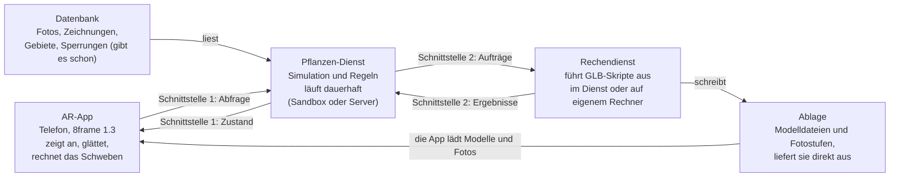

# Pflanze: Schnittstellen

Stand: 24. Oktober 2026. Online-Fassung zum Kommentieren:
https://claude.ai/artifact/PGTvwXn1meUdcQd3fFuXYs

## Kurz erklärt

Eine Schnittstelle ist die feste Absprache zwischen zwei Programmteilen darüber,
welche Daten der eine dem anderen gibt: welche Felder, was sie bedeuten, in welcher
Einheit. Solange beide Seiten sich daran halten, kann jede Seite für sich gebaut,
geändert und getestet werden.

Bei der Pflanze gibt es drei Teile, die getrennt entstehen:

- **die AR-App** auf dem Telefon, die die Pflanze zeigt. Ich baue zuerst eine
  Testfassung.
- **den Pflanzen-Dienst** auf dem Server, in dem die Simulation läuft. Den richtet
  der Admin ein.
- **den Rechendienst**, der die GLB-Skripte ausführt. Er läuft im Pflanzen-Dienst
  mit oder später auf einem eigenen Rechner.

Zwischen ihnen liegen zwei Schnittstellen:

1. **Server → AR-App:** Was fragt die App ab, und was bekommt sie zurück? Das ist
   die wichtige. An ihr arbeiten der Admin und ich gleichzeitig, von zwei Seiten.
2. **Simulation ↔ Rechendienst:** Welche Aufträge schickt die Simulation, und was
   kommt zurück? Die ist im Code schon festgelegt und wird erst wichtig, wenn der
   Rechendienst auf einen anderen Rechner muss.



Die Datenbank mit Fotos und Zeichnungen gibt es auf der Plattform schon. Neu sind
Pflanzen-Dienst, Rechendienst und Ablage. In der Sandbox stecken alle drei in einem
Programm auf dem Mac.

**Warum das Dokument hilft:** Heute liefert die Sandbox ihrem Viewer alles, was die
Simulation weiß, in einer Form, die mit dem Viewer gewachsen ist. Die AR-App
braucht viel weniger, dafür in einer festen Form. Steht diese Form hier fest, kann
die Sandbox sie liefern, und die AR-Testfassung läuft gegen die Sandbox. Baut der
Admin seine Abfrage im Backend in derselben Form, läuft dieselbe AR-Fassung später
ohne Änderung gegen den Server.

**Der wichtigste Grundsatz:** Die App rechnet keine Simulation nach. Sie bekommt für
jedes Objekt die fertige Lage im Raum, die fertige Datei und die fertigen Werte für
den Look und zeigt nur an. Alle Regeln bleiben auf dem Server. Zwischen zwei
Abfragen glättet die App die Bewegung, und das Schweben rechnet sie selbst, weil es
nur Anzeige ist.

Die Felder unten sind ein Vorschlag. Namen und Form lassen sich noch ändern, bis
Admin und AR-Testfassung darauf aufbauen.

## Schnittstelle 1: Server → AR-App

Die App fragt regelmäßig den Zustand der Pflanze in ihrer Nähe ab und bekommt jedes
Mal ein vollständiges Bild: alle Objekte mit Lage, Datei und Look. Vorschlag:

**Abfrage:** `plantNearby(lat, lng)` im GraphQL-Backend, wie die bestehenden
Abfragen `postsNearby` und `strokesNearby`. Sie liefert die Pflanzen im Umkreis,
meist keine oder eine. In der Sandbox liefert `GET /api/plant` dieselbe Form für die
eine Pflanze, die dort läuft.

**Wie oft:** alle paar Sekunden, solange die Pflanze sichtbar ist. Der Server sagt
im Feld `pollSeconds`, wie oft. In Echtzeit bewegt sich die Pflanze langsam, dort
reichen etwa 3 Sekunden. Die beschleunigte Sandbox schickt einen kleineren Wert.

**Glätten:** Die App zeigt die Pflanze um einen Abfrageabstand verzögert und blendet
zwischen den letzten zwei Antworten weich über, wie der Viewer der Sandbox.
Gemessen wird dabei mit der Serverzeit aus der Antwort (`serverTime`), nicht mit der
Uhr des Telefons.

**Modelldateien:** Jede Version eines Objekts hat ihre eigene Datei mit eigenem
Namen. Eine Datei ändert sich nie, sie darf also dauerhaft zwischengespeichert
werden. Ändert sich die URL eines Objekts, lädt die App die neue Datei im
Hintergrund und tauscht erst, wenn sie da ist. Bis dahin bleibt die alte stehen.

**Kurz als Ablauf:**

1. App sendet `plantNearby(lat, lng)`.
2. Server antwortet mit Pflanze, Objekten, Zeichnungen und `serverTime`.
3. App lädt fehlende Modelle und Fotos, entfernt Objekte, die nicht mehr in der
   Antwort stehen, und fügt neue hinzu.
4. Nach `pollSeconds` wieder von vorn.

## Die Pflanze als Ganzes

| Feld | Typ | Bedeutung |
| --- | --- | --- |
| `id` | Text | Kennung der Pflanze |
| `location` | `{ lat, lng }` | Pflanzpunkt. Alle Lagen der Objekte sind Meter von hier aus. |
| `serverTime` | Zahl, Millisekunden | Zeitpunkt, für den diese Antwort gilt |
| `pollSeconds` | Zahl | wann die App wieder fragen soll |
| `phase` | Text | `wachstum`, `plateau`, `abstieg`, `verfall`, `ende` (nur zur Anzeige und Fehlersuche) |
| `objects` | Liste | alle sichtbaren Objekte, auch tote, die gerade einsinken |
| `drawings` | Liste | Zeichnungen, die die Pflanze angezogen hat oder gerade anzieht |

**Richtungen:** Lagen sind Meter in einem Rahmen, der nach Norden ausgerichtet ist:
x nach Osten, y nach oben, z nach Süden. Das ist derselbe Rahmen wie bei den
Zeichnungen der Plattform (`Stroke`: x Osten, y Höhe, z = −Norden), und die
Simulation rechnet schon heute so. Die App legt die Pflanze also an `location` ab,
richtet den Rahmen nach Norden aus und setzt jedes Objekt mit seiner Lage hinein,
genau wie eine Zeichnung.

Felder wie Zeitfaktor, Budget oder Protokoll bleiben draußen. Die App braucht sie
nicht, und an dem, was man sieht, ändern sie nichts.

## Ein Objekt

| Feld | Typ | Bedeutung |
| --- | --- | --- |
| `id` | Text | bleibt ein Objektleben lang gleich. Beim Verschmelzen behält das Ziel seine Kennung, das wandernde Objekt verschwindet. Beim Halbieren behält eine Hälfte die Kennung, die andere ist neu. |
| `model.url` | Text | die GLB-Datei, die gerade gilt (Auslieferungsfassung) |
| `model.triangles` | Zahl | Dreiecke der Datei, nur zur Anzeige und Fehlersuche |
| `pose.position` | `[x, y, z]`, Meter | wo der Ursprung des Modells steht, vom Pflanzpunkt aus |
| `pose.rotation` | `[x, y, z, w]`, Quaternion | Drehung des Modells |
| `pose.scale` | Zahl | gleichmäßige Größe des Modells |
| `state` | Text | `keimling`, `aktiv`, `verwelkend`, `tot` |
| `origin` | ja/nein | Ursprungsobjekt |
| `tint` | `{ color: [r, g, b], intensity }` oder leer | Leuchtfarbe: Farbe 0 bis 1 (sRGB), `intensity` geht direkt als Leuchtstärke ins Material |
| `grain` | `{ strength, scale }` | Werte für `grain-shimmer`: `grain` und `grainScale` |
| `sway` | `{ height, period }` | Schweben: Höhe in Metern, Takt in Sekunden, 0 = ruhig |
| `photo` | `{ url, frame }` oder leer | Foto, schon in der passenden Stufe zerdrückt und gesättigt (stärker mit jeder Verschmelzung, Halbierung und Komprimierung des Objekts), und seine Projektion `frame` im Koordinatensystem des Modells: `dir` (Einheitsvektor zum Foto), `right` und `up` (Achsen des Bildes), `min` und `max` (Ausdehnung des Bildes entlang `right` und `up`) |
| `comment` | `{ text, color, frame }` oder leer | Kommentar, den das Objekt übernommen hat: sein Text, die Schriftfarbe und die Projektion `frame` wie bei `photo` |

**Alles steckt in `pose`:** Aus dem Boden wachsen, Höhe über dem Boden, Neigung,
Größe nach dem Verschmelzen, Schrumpfen im Verfall, Einsinken nach dem Tod und die
Reise zum Partner rechnet der Server in diese drei Werte ein. Die App setzt sie nur
aufs Modell. Die Sandbox rechnet sie heute schon so für ihre Bewegungsframes
(`modelMatrix` in `sim/world.ts`).

**Fertige Werte für den Look:** Die Leuchtstärke ist schon so umgerechnet, dass jede
Farbe gleich hell wirkt. Die Körnung ergibt sich aus den Dreiecken und der Höhe des
Modells. Beides rechnet heute der Viewer selbst und zieht auf den Server um, damit
alle Regeln für den Look an einer Stelle liegen.

**Tote Objekte** stehen weiter in der Liste, solange sie einsinken. `state: tot` ist
für die App nur ein Hinweis, das Einsinken steckt in `pose`. Ist ein Objekt aus der
Liste verschwunden, entfernt die App es.

**Beispiel einer Antwort** mit einem Objekt und einer Zeichnung, gekürzt:

```json
{
  "id": "pflanze-1",
  "location": { "lat": 50.1069, "lng": 8.6625 },
  "serverTime": 1792612800000,
  "pollSeconds": 3,
  "phase": "plateau",
  "objects": [
    {
      "id": "o12",
      "model": { "url": "/plant/pflanze-1/o12-j87-fuse-p4.glb", "triangles": 4210 },
      "pose": { "position": [0.84, 0.62, -1.10], "rotation": [0, 0.38, 0, 0.92], "scale": 0.71 },
      "state": "aktiv",
      "origin": false,
      "tint": { "color": [1, 0.35, 0], "intensity": 0.06 },
      "grain": { "strength": 0.02, "scale": 1830 },
      "sway": { "height": 0.004, "period": 17.2 },
      "photo": null
    }
  ],
  "drawings": [
    { "strokeId": "65f0c2", "position": [1.9, 1.2, 0.4], "scale": 0.8, "state": "angezogen", "textureFrom": null }
  ]
}
```

## Bewegung zwischen zwei Abfragen

In Echtzeit bewegt sich die Pflanze langsam. Eine Reise zum Partner dauert bei
Zeitfaktor 1 mindestens rund 10 Stunden, bei einer weichen Verschmelzung 2,5 Tage.
Die schnellste, die Eröffnung der Vorläufer, dauert rund 18 Minuten. Wind,
Zusammenrücken und Einsinken laufen über Stunden. Zwischen zwei Abfragen im Abstand
von 3 Sekunden ändert sich eine Lage also nur wenig. Daraus folgt eine einfache
Regel:

**Die App blendet zwischen den letzten beiden Antworten über.** Sie zeigt den Stand
um `pollSeconds` verzögert. Lage und Größe gehen gerade von einem Wert zum nächsten,
die Drehung auf dem kürzesten Weg (slerp). So sieht jede Bewegung gleich aus, egal
ob sie aus einer Reise, aus Wind oder aus dem Einsinken kommt. Die App muss nicht
wissen, warum sich etwas bewegt.

**Das Schweben rechnet die App selbst,** weil es nur Anzeige ist und die Simulation
nicht berührt. Ein Objekt hebt sich aus seiner Lage um bis zu `sway.height` Meter
und senkt sich wieder, mit dem Takt `sway.period`:

```
Versatz nach oben = height × (1 − cos(2π · t / period + φ)) / 2
```

Dabei ist t die Zeit in Sekunden auf dem Telefon und φ eine zufällige Phase pro
Objekt, damit nicht alle im Gleichtakt wippen. So macht es auch der Viewer der
Sandbox.

**Sprünge, die gewollt sind:**

- **Verschmelzung am Ziel:** Das Ziel bekommt eine neue Datei, das wandernde Objekt
  verschwindet aus der Liste. Die App tauscht beides gleichzeitig, sobald die neue
  Datei geladen ist.
- **Halbierung:** Das Objekt bekommt eine neue Datei, und daneben erscheint die
  zweite Hälfte mit neuer Kennung.
- **Neuer Keimling:** Er erscheint mit kleiner Größe im Boden und wächst über die
  nächsten Antworten heraus.

Ein neues Objekt wird ohne Überblendung an seine erste Lage gesetzt. Ein Objekt, das
nicht mehr in der Antwort steht, verschwindet.

**In der beschleunigten Sandbox** kann sich zwischen zwei Abfragen viel mehr tun.
Deshalb schickt sie einen kleineren `pollSeconds`-Wert. Der Viewer nutzt dort weiter
die feineren Bewegungsframes (`/api/frames`), die AR-Testfassung die Schnittstelle.

## Zeichnungen, Fotos und Kommentare

**Zeichnungen** gibt es auf der Plattform schon als eigene Inhalte (`Stroke`: Linien
mit Punkten, Farbe und Dicke, an einem Ort). Die App zeichnet sie heute schon
selbst. Die Pflanze erfindet keine neuen Zeichnungen, sie bewegt vorhandene. Deshalb
verweist die Schnittstelle nur auf die Zeichnung und sagt, wo sie gerade ist:

| Feld | Typ | Bedeutung |
| --- | --- | --- |
| `strokeId` | Text | die Zeichnung, wie sie `strokesNearby` liefert |
| `position` | `[x, y, z]`, Meter | wo ihr Ankerpunkt gerade ist, vom Pflanzpunkt aus |
| `scale` | Zahl | ihre Größe, 1 bis 0,5 (sie schrumpft auf dem Weg zum Objekt) |
| `state` | Text | `angezogen` (unterwegs) oder `ruhend` (hängt am Objekt) |
| `textureFrom` | Text oder leer | ruhend: die Modelldatei, deren Textur die Zeichnung übernimmt |

Die App zeichnet eine Zeichnung, die hier steht, an dieser Stelle statt an ihrem
eigenen Ort. Eine freie Zeichnung, die die Pflanze noch nicht angezogen hat, steht
nicht in der Liste und erscheint wie gewohnt an ihrem Ort. Wie die übernommene
Textur auf einer Linie aussehen soll, ist noch offen. Die Sandbox legt sie auf die
Röhre der Linie, mit demselben Material wie die Plattform (`render/stroke-tube.ts`),
in Längsrichtung achtmal wiederholt.

**Fotos** kommen als fertige Bilddatei im Feld `photo.url` eines Objekts. Die App
projiziert sie aus der Richtung `photo.frame.dir` auf das Modell:

- Ein Punkt `p` des Modells bekommt die UV-Koordinaten
  `u = (p·right − min[0]) / (max[0] − min[0])` und
  `v = 1 − (p·up − min[1]) / (max[1] − min[1])`.
- Das Bild füllt diesen Rahmen und behält seine Proportionen. Was übersteht, wird
  abgeschnitten.
- Nur Dreiecke, die die Projektion direkt trifft, zeigen das Foto. Die anderen
  liegen im Schatten und behalten die eigene Textur. Das prüft ein Tiefenpuffer von
  256 × 256 aus Sicht des Fotos: Ein Dreieck ist getroffen, wenn es dort
  mindestens ein Pixel vorne liegt.
- Weil alles aus Modell und Rahmen folgt, sieht es auf jedem Gerät gleich aus.

Den Rahmen rechnet der Server bei der Übernahme und nach jeder Verschmelzung neu.
Beim Halbieren bekommen beide Hälften denselben Rahmen, zusammen zeigen sie das
ganze Bild. Die Sandbox macht die Projektion in `litTriangles`, `splitLit`,
`projectedUv` und `fitPhoto` (`render/photo-layer.ts`), den Rahmen in `aimPhoto`
(`sim/world.ts`). Der Server
erzeugt die gesättigten und zerdrückten Fassungen selbst aus dem Foto in der
Datenbank und legt sie neben die Modelle, wie die Sandbox es heute tut
(`/api/photo/<foto>/<stufe>/<veränderungen>`). Wird
ein Foto gesperrt oder läuft es ab, fällt `photo` bei der nächsten Antwort weg, und
das Objekt zeigt wieder seine eigene Textur. Die Sandbox kennt diesen Ablauf schon,
auf dem Server fehlt noch die Verbindung zur Moderation.

**Kommentare** sind die Textbeiträge der Plattform (`Post`, über `postsNearby`).
Die App stellt sie wie gewohnt an ihrem Ort dar. Hat ein Objekt einen Kommentar
übernommen, steht er in seinem Feld `comment`: Die App schreibt den Text auf eine
Leinwand, so wie sie es für Kommentare tut (`canvastext`: fett,
`NeueMontreal, Helvetica`, umbrochen), mit dem Seitenverhältnis des Rahmens. Die
Schrift ist halb so groß, wie sie den Rahmen füllen würde, steht in der Mitte und
ist leicht durchsichtig (Deckkraft 0,7). Sie legt die Leinwand als Alpha-Maske in der Farbe
`color` mit derselben Projektion und demselben Schatten wie ein Foto über das
Objekt, unbeleuchtet wie die Kommentare in der App. Die Sandbox macht es so in
`render/comment-layer.ts` und `render/comment-text.ts`, für den Viewer und die
AR-Testfassung gleich. Wird ein Kommentar
gesperrt oder läuft er ab, fällt `comment` bei der nächsten Antwort weg.

## Pflanzen: App → Server

Bevor eine Pflanze läuft, pflanzen Besucher ihre Ursprungsobjekte in der App
(Ablauf in [Phasen](PHASEN.md#pflanzen)). Die Sandbox bietet dafür zwei Abrufe an,
die AR-Testfassung und der Viewer nutzen sie. Auch das ist ein Vorschlag.

**`GET /api/planting`** sagt, was gepflanzt werden kann und nach welchen Regeln:

| Feld | Bedeutung |
| --- | --- |
| `waiting` | ja: Die Sandbox wartet auf eine Pflanzung. Nein: Es läuft schon eine Pflanze. |
| `catalog` | die pflanzbaren Objekte: `name`, `label`, `glb`, `triangles`, `min`, `max` (Maße der Datei) |
| `rules` | `originMinSize`, `originMaxSize` (m, längste Seite), `originMaxGap` (m, Kante zu Kante), `plantMinObjects`, `plantMaxObjects` |
| `plantingPoint` | wenn schon eine Pflanze läuft: ihr Pflanzpunkt im Rahmen der Pflanzung |

Die Modelle zum Platzieren liefert `GET /api/planting/models/<glb>`.

**`POST /api/planting`** mit `{ plants, seed }` startet die Pflanze. `plants` ist die
Liste in der Reihenfolge des Pflanzens, jedes Objekt mit `name`, `pos` (`[x, 0, z]`,
Meter), `size` (Meter, längste Seite) und `rotY` (Drehung um die Hochachse,
Bogenmaß). `seed` ist eine ganze Zahl von 0 bis 99. Der Server prüft Anzahl, Größen
und Abstände noch einmal und antwortet mit:

| Feld | Bedeutung |
| --- | --- |
| `plantingPoint` | der Pflanzpunkt im Rahmen der Pflanzung. Lagen aus Schnittstelle 1 zählen von hier. |
| `values` | alles, was derselbe Lauf noch einmal braucht: `params`, `scenario` (mit Seed), `plants`, `speed`, `fuseMode`, `commit` |
| `file` | ein Dateiname dafür. Die Pflanzszene speichert `values` unter diesem Namen. |

Läuft schon eine Pflanze, antwortet die Sandbox mit 409. Wohin der Server der
Plattform eine Pflanzung speichert, ist noch offen.

## Schnittstelle 2: Simulation ↔ Rechendienst

Will die Simulation ein Modell verändern, schreibt sie einen **Auftrag**
(`JobRequest`). Der Rechendienst führt das passende Skript aus und gibt ein
**Ergebnis** zurück (`JobResult`). Die Simulation übernimmt das Ergebnis genau zu
seinem Fälligkeitstermin in Eigenzeit, nie früher. Deshalb läuft eine Pflanze
gleich, egal wie schnell gerechnet wird. Ist das Ergebnis zum Termin nicht da,
wartet die Uhr. Beides ist in `sandbox/sim/types.ts` festgelegt.

**Der Auftrag, die wichtigsten Felder:**

| Feld | Bedeutung |
| --- | --- |
| `id` | laufende Nummer |
| `kind` | `copy`, `compress`, `split`, `crush`, `pose` oder `fuse` |
| `objectId`, `partnerId` | welches Objekt, beim Verschmelzen auch das wandernde |
| `dueAt` | Fälligkeit in Eigenzeit: meist 0,4 Eigentage nach dem Auftrag, weiche Verschmelzung 2,5, Vorläufer 0 |
| `recipe` | Schritt der Teststrecke: `p2` bis `p13d`, `copy` oder `reduce` |
| `keep` | Kopie und Komprimierung: Anteil der Dreiecke, der bleibt |
| `force`, `final` | Komprimierung erzwingen, letzte Komprimierung eines Ursprungsobjekts |
| `level` | Zerdrücken: neue Stufe |
| `seed` | Halbieren und Verschmelzen: Startwert, damit das Ergebnis wiederholbar ist |
| `voxelCells`, `faces` | Kopie: Voxelraster oder Ziel-Dreiecke der Stilisierung |
| `fuseMode`, `overlap`, `fusePost` | Verschmelzen: hart oder weich, erlaubte Überschneidung, Nachbearbeitung |
| `halving` | Halbieren: auf welchen Anteil die Hälften kommen, Texturen zerdrücken ja oder nein |

Felder wie `spawn`, `generation` oder `pioneer` braucht nur die Simulation selbst.
Der Rechendienst übergeht sie.

**Das Ergebnis:**

| Feld | Bedeutung |
| --- | --- |
| `jobId` | zu welchem Auftrag |
| `outputs` | die neue Modellfassung: Datei, Dreiecke, Maße (`min`, `max`). Beim Halbieren zwei, sonst eine. |
| `bMatrix` | Verschmelzen: wo das wandernde Modell im Ergebnis sitzt, 16 Zahlen |

Scheitert ein Skript oder läuft es länger als 15 Minuten, gilt der Auftrag als
gescheitert. Die Objekte bleiben unverändert, ein Paar löst sich auf.

**Heute** läuft beides in einem Prozess: `sandbox/runner/jobs.ts` übersetzt den
Auftrag in Skriptaufrufe (welches Skript mit welchen Einstellungen) und liest das
Ergebnis aus der neuen Datei.

**Mit einem eigenen Rechner** würde der Auftrag über eine Warteschlange gehen, etwa
eine Sammlung in MongoDB oder eine kleine HTTP-Schnittstelle. Dazu kommen zwei
Felder: die URLs der Eingabedateien im Auftrag, weil der Rechendienst die Modelle
dann nicht mehr auf derselben Platte findet, und die URL der neuen Datei im
Ergebnis. An der Simulation ändert das nichts.

**Mit vorbereiteten Keimling-Varianten** beantwortet der Dienst Kopieraufträge aus
dem Vorrat, ohne ein Skript zu starten. Das Ergebnis ist dasselbe, nur sofort da.

## Was als Nächstes passiert

**In der Sandbox, erledigt:**

1. `GET /api/plant` liefert genau die Form von Schnittstelle 1. Lage, Leuchtstärke,
   Körnung und Schweben rechnet er aus der Simulation (`sim/look.ts`). Die Sandbox
   hat keinen echten Ort, `location` ist fest.
2. Die AR-Testfassung (`src/plant-live.ts`) holt ihn über den Vite-Server von
   `npm run dev:ar`, der `/api` und `/run` an die Sandbox weiterreicht
   (`PLANT_SANDBOX`, sonst Port 5180). So läuft alles über HTTPS, das die Kamera am
   Telefon braucht. Zeichnungen zeigt sie noch nicht: Die Antwort verweist auf `Stroke`-Daten der
   Plattform, und die gibt es in der Sandbox nicht.
3. Der Viewer bleibt, wie er ist. Er braucht weiter alle Felder für seine Anzeigen.

**Auf dem Server, der Admin:** die Abfrage `plantNearby` in dieser Form, sobald der
Pflanzen-Dienst läuft. Bis dahin kann die AR-App gegen die Sandbox entwickelt
werden.

**Offene Fragen:**

- **Hinschauen zählen:** Jede Abfrage `plantNearby` kommt von einem Gerät in der
  Nähe. Sie könnte also gleich als Hinschauen zählen, mit einer anonymen Kennung pro
  Sitzung, die ein paar Minuten gültig bleibt. Das würde die fehlende Gerätezählung
  lösen. Der Admin entscheidet.
- **Wie oft abfragen:** 3 Sekunden sind ein Vorschlag. Später könnte der Server
  Änderungen auch per Subscription schicken, wie bei neuen Posts.
- **Mehrere Pflanzen in Reichweite:** Die App zeigt alle aus der Antwort. Ob Pflanzen
  sich so nahe kommen dürfen, regelt der Sperrradius beim Pflanzen.
- **Datenmenge:** Jede neue Modellfassung muss jedes Telefon laden. Ob die App bei
  vielen Objekten die fernen später lädt, zeigt der AR-Test.
- **Textur auf Zeichnungen:** Wie eine Linie die Textur eines Objekts übernimmt, ist
  noch nicht festgelegt.
- **Feldnamen:** Bis die erste Fassung auf beiden Seiten läuft, dürfen Namen und Form
  sich noch ändern. Danach nur noch nach Absprache.
