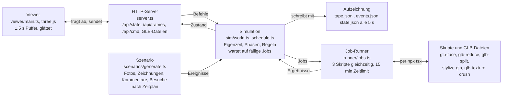

# Pflanze auf an-alle.net: technische Voraussetzungen

Stand: 24. Oktober 2026. Referenz für den Betrieb der Pflanze auf der Plattform.
Online-Fassung zum Kommentieren: https://claude.ai/artifact/9wTdGyYU9gNCuD2QaL6grA

Die konkreten Schritte am Server nach Priorität: [Aufgaben für den Admin](ADMIN-AUFGABEN.md).
Verwandte Dokumente: [Phasen der Pflanze](PHASEN.md),
[Zeitmaßstab und Time Boosts](ZEITMASSSTAB-UND-BOOSTS.md),
[offene Punkte für den Server](../SERVER-OFFENE-PUNKTE.md).

## Kurzfassung

Die Pflanze lässt sich auf dem bestehenden Uberspace betreiben. Sie braucht dort
aber vier neue Teile, die es heute nicht gibt:

- einen dauerhaft laufenden Simulationsdienst
- einen Rechendienst für die GLB-Skripte
- Speicher für die Modelldateien
- eine Schnittstelle, über die die AR-App den Zustand der Pflanze liest

Die Simulation selbst ist fertig und unabhängig von der Sandbox. Sie lässt sich
so, wie sie ist, ins Backend übernehmen.

Die größten offenen Punkte:

1. **Neustart:** Ein Lauf überlebt keinen Neustart des Dienstes.
2. **Bildbibliothek:** Der Server läuft auf CentOS 7 mit glibc 2.17. Alle
   GLB-Skripte laden die Bildbibliothek `sharp`, deren fertige native Pakete erst
   ab glibc 2.26 laufen. Die WebAssembly-Variante von `sharp` läuft überall und
   ist lokal mit allen Skripten getestet, auf dem Server aber noch nicht. Das ist
   der wichtigste Test vor allem anderen (siehe
   [Ungetestete Funktionen](#ungetestete-funktionen)). Scheitert er, gibt es einen
   lokal getesteten Ausweichweg ohne `sharp`.
3. **Speicher:** Ein vollständiger Lebenszyklus hat in der Sandbox 0,3 bis 1,2 GB
   und 1 000 bis 2 900 Modelldateien erzeugt.
4. **Rechenzeit:** Eine weiche Verschmelzung braucht 30 bis 100 Sekunden. Mehrere
   Pflanzen teilen sich denselben Rechner mit Backend und Datenbank.
5. **Telefon:** Ob ein Telefon bis zu 70 Modelle gleichzeitig flüssig darstellt,
   ist nicht getestet.

Grundlage: das Backend-Repo der Plattform (Stand 5. Oktober 2026), ein lesender
Blick auf den Server der Plattform am 21. Oktober 2026 und
die Sandbox im Branch `plant` des Repos `working-on-democracy/ar-module-template`.

## Wie die Sandbox funktioniert

Die Sandbox ist ein lokaler Node-Server (`npm run sandbox`), der eine Pflanze
simuliert, ihre Rechenjobs mit den echten Skripten ausführt und alles in einem
Lauf-Ordner unter `sandbox-runs/` ablegt. Ein Viewer im Browser zeigt sie in 3D.

- **Simulation** (`sandbox/sim/`): kennt alle Regeln und Phasen. Sie macht feste
  Schritte von höchstens 0,01 Kalendertagen, rechnet die Eigenzeit mit dem
  Zeitfaktor hoch und gibt jede Veränderung an einem Modell als Job mit
  Fälligkeitstermin aus. Ist ein Ergebnis fällig und noch nicht fertig, wartet
  sie. Deshalb ergibt derselbe Seed immer denselben Lauf, egal wie schnell die
  Skripte sind.
- **Job-Runner** (`sandbox/runner/jobs.ts`): wählt pro Job das Rezept der
  Teststrecke und ruft die Skripte auf, höchstens drei gleichzeitig. Jedes
  Ergebnis ist eine neue Datei.
- **HTTP-Server** (`sandbox/server.ts`): Er steuert das Tempo (`--speed`, Standard
  Echtzeit), schreibt Protokoll und Aufzeichnung und liefert dem Viewer Zustand,
  Bewegungsframes und Modelle. Befehle aus dem Viewer (Foto, Zeichnung, Geräte,
  Pause, Tempo) gehen an die Simulation.
- **Viewer** (`sandbox/viewer/`): three.js im Browser. Er spielt 1,5 Sekunden
  hinter dem neuesten Frame und glättet die Bewegungen dazwischen.
- **Aufzeichnung**: `tape.jsonl` hält jeden Schritt und jedes Ergebnis fest.
  `--replay` spielt einen Lauf ohne neues Rechnen exakt wieder ab und meldet, wenn
  er abweicht.

Der Lebenszyklus-Rechner nutzt dieselbe Simulation, ersetzt die Skripte aber durch
Zahlen (`sim/abstract-jobs.ts`). So lässt sich ein ganzer Lebenszyklus in Sekunden
rechnen.

**Bedienung:** `npm run sandbox` startet einen neuen Lauf auf Port 5180, mit
`-- --seed 12` einen bestimmten Seed, mit `-- --replay sandbox-runs/<Ordner>` eine
Wiedergabe. Mit `npm run lifecycle-page` wird der Rechner gebaut,
`npx tsx sandbox/measure-seeds.ts` misst die Phasen über 10 Seeds.

## Skripte und Werkzeuge

Jeder Rechenschritt ist ein eigenständiges TypeScript-Skript aus `scripts/` im
Template-Repo. Es liest eine GLB-Datei und schreibt eine neue. Gestartet wird es
über `npx tsx` als eigener Prozess.

| Skript | Aufgabe in der Pflanze | Pakete |
| --- | --- | --- |
| `glb-fuse.ts` | Verschmelzen (hart, weich), Voxelisieren, Lage für die Reise | `manifold-3d`, `three`, `three-mesh-bvh`, `meshoptimizer`, `@gltf-transform/*` |
| `glb-reduce.ts` | Reduktion, Komprimierung, erzwungene Komprimierung | `meshoptimizer`, `@gltf-transform/*` |
| `glb-split.ts` | Halbieren | `meshoptimizer`, `@gltf-transform/*` |
| `stylize-glb.ts` | Phase 2, 7 und 8: Stilisierung | `jimp`, `meshoptimizer`, `@gltf-transform/*` |
| `glb-texture-crush.ts` | Phase 9 und 13: Texturen zerdrücken | `jimp`, `@gltf-transform/*` |
| `sandbox/runner/glb-info.ts` | Dreiecke und Maße eines Ergebnisses lesen | `@gltf-transform/*` |

`manifold-3d`, `meshoptimizer` und `jimp` sind WebAssembly oder reines JavaScript.
Aber `@gltf-transform/functions` lädt beim Start fest `sharp` (über
`ndarray-pixels`), auch wenn kein Skript dessen Bildfunktionen nutzt. Damit braucht
jedes Skript ein ladbares `sharp`. Lokal ist das die native Variante. Auf CentOS 7
kommt nur die WebAssembly-Variante `@img/sharp-wasm32` in Frage, auf die `sharp`
von selbst ausweicht.

Dazu kommen:

- **Node.js** mit `tsx`. Die Sandbox läuft lokal mit Node 26, auf dem Server ist
  Node 20 eingestellt, 22 ist verfügbar.
- **Der Zwischenspeicher für Verschmelzungen** (`--cache`): ein Ordner, in dem
  jedes Modell nur einmal für das Verschmelzen vorbereitet wird. In der Sandbox
  sind das derzeit 73 MB.
- **Für die Auslieferung ans Telefon** käme `gltfpack` (npm-Paket, WebAssembly)
  und `sharp` für WebP-Texturen dazu, wie in `glb-compression.ts`. Die Sandbox
  liefert unkomprimierte Dateien aus.

Die Skripte und die Simulation brauchen keine Datenbank und kein Netz. Die
Simulation (`sandbox/sim/`) ist reines TypeScript ohne Abhängigkeiten.

## Die Plattform heute

an-alle.net läuft auf einem Uberspace. Das Backend liegt in einem eigenen, privaten
Repo.

| Teil | Stand |
| --- | --- |
| Server | CentOS 7, glibc 2.17, geteilt mit anderen Konten, kein Swap |
| Backend | Node 20, TypeScript, Express, Apollo GraphQL, Socket.IO, als supervisor-Dienst, erreichbar unter `/graphql` |
| Datenbank | MongoDB 6.0 als supervisor-Dienst `mongodb`, Fotos als JPEG direkt in der Datenbank |
| Frontend | Vue und 8frame 1.3.0, statisch unter `~/html`, daneben Admin-Oberfläche und weitere statische Seiten |
| Bilder im Backend | `jimp` (reines JavaScript), kein `sharp` |
| Inhalte | Text-Posts, Fotos (höchstens 1 024 px, JPEG-Qualität 70) und Zeichnungen (Linien mit Punkten, keine Modelle), jeweils mit Ort |
| Lebensdauer | pro Verfügbarkeitsgebiet einstellbar, Standard 90 Tage, berechnet aus Erstellzeit und Gebiet, ein Sweeper löscht Abgelaufenes |
| Speichergrenze | ab 7 GB Datenbankgröße werden alle Fotos und Zeichnungen gelöscht |
| Abfragen | Inhalte im Umkreis von 50 m, die App fragt Fotos alle 10 s ab, neue Posts kommen per Subscription |
| AR-Module | eigene Datensammlung: Text, URL, Ort, Kategorie, an- und abschaltbar |
| Auslieferung | `scripts/deploy.sh` auf dem Server: pull, bauen, Dateien tauschen, Dienst neu starten |

**Was die Pflanze davon nutzen kann:** Fotos und Zeichnungen mit Ort, die
Verfügbarkeitsgebiete, die Moderation (gesperrte Fotos), den
supervisor-Mechanismus und das Muster von `deploy.sh`.

**Was es für die Pflanze noch nicht gibt:**

- Gerätezählung: Der Echo-Dienst sieht Geräte in einer 50-m-Zelle, aber nur für
  eine Stunde und nicht als Zählung pro Pflanze.
- Ablage für Modelldateien außerhalb der Datenbank.
- Ein Hintergrunddienst, der dauerhaft rechnet. Das Backend reagiert heute nur auf
  Anfragen und löscht Abgelaufenes.

## Was auf dem Server nötig ist

Ein Vorschlag in sechs Teilen. Alle Teile passen in das bestehende Muster aus
supervisor-Diensten, statischen Dateien unter `~/html` und `deploy.sh`.

**1. Simulationsdienst.** Ein eigener supervisor-Dienst, etwa
`~/etc/services.d/plant.ini`, getrennt vom Backend-Dienst. Er führt die Simulation
in Echtzeit aus, wie die Sandbox mit `--speed echtzeit`, und schreibt den Zustand
regelmäßig weg. Getrennt deshalb, damit ein Absturz oder Neustart der Pflanze die
übrige Plattform nicht mitnimmt und umgekehrt. Er braucht:

- Lesezugriff auf MongoDB für Fotos, Zeichnungen, Sperrungen und Gebiete im Umkreis
  der Pflanze
- eine Zählung der Geräte im Umkreis, die es noch nicht gibt
- `autorestart=yes`, damit er nach einem Absturz wieder anläuft

**2. Rechendienst.** Er nimmt die Jobs der Simulation entgegen und startet die
Skripte.

- höchstens 2 bis 3 Skripte gleichzeitig (die Sandbox nimmt 3), mit `nice`, damit
  Backend und Datenbank Vorrang behalten
- Zeitlimit 15 Minuten pro Skript, wie in der Sandbox
- der gemeinsame Zwischenspeicher für Verschmelzungen als fester Ordner, etwa
  `~/plant-data/fuse-cache`
- kann im Simulationsdienst laufen oder getrennt davon. Getrennt lässt er sich
  später auf einen anderen Rechner verlegen

**3. Ablage der Modelle.** Die Modelle gehören auf die Platte, nicht in MongoDB,
sonst zählen sie gegen die 7-GB-Grenze, die Fotos und Zeichnungen löscht.

- Arbeitsdateien (unkomprimiert, nur für weitere Jobs) außerhalb von `~/html`,
  etwa `~/plant-data/<pflanze>/glb/`
- Auslieferungsdateien (komprimiert mit `gltfpack` und WebP) unter
  `~/html/plant/<pflanze>/`, damit Apache sie direkt ausliefert und das Backend
  nicht belastet. Komprimiert wird immer aus der Arbeitsdatei, nie aus einer schon
  komprimierten
- eine Aufräumregel: Dateien, die kein lebendes Objekt mehr braucht, nach einer
  Schonfrist löschen

**4. Schnittstelle.** Eine GraphQL-Abfrage im bestehenden Backend, etwa
`plantNearby(lat, lng)`, die Objekte mit Datei-URL, Lage, Größe, Neigung,
Leuchtfarbe, Schweben und laufenden Reisen liefert, dazu angehängte Zeichnungen.
Die genaue Form der Felder steht in [SCHNITTSTELLEN.md](SCHNITTSTELLEN.md).
Neue Felder im Schema heißen: Backend und Frontend müssen zusammen ausgeliefert
werden, wie `deploy.sh` es schon vorsieht.

**5. Darstellung in der AR-App.** Eine Komponente im Frontend, die die Objekte am
Ort der Pflanze darstellt, Bewegungen zwischen zwei Abfragen glättet wie der Viewer
der Sandbox und Modelle erst lädt, wenn sie gebraucht werden. Zum Look gehört die
Körnung von `grain-shimmer` (`src/a-frame-components/grain-shimmer.ts`), dieselbe wie
im Viewer der Sandbox. Eine Fassung davon läuft schon gegen die Sandbox
(`src/plant-live.ts`, [AR-Testumgebung](AR-TESTUMGEBUNG.md)) und kann als Vorlage
dienen. Dazu gehören eine unsichtbare Fläche, die verdeckt, was im Boden steckt, und
Schatten der Objekte auf den Boden.

**6. Vorbereitung beim Erstellen eines Ursprungsobjekts.** Ein Objekt wird mit
Sloyd erstellt, lange bevor es gepflanzt wird. In dieser Zeit lassen sich alle
Keimling-Varianten seiner Linie schon rechnen. Größe, Neigung und Leuchtfarbe eines
Keimlings sind Werte der Simulation, nicht Teil der Datei. Deshalb braucht jede
Generation nur eine Datei, die jeder Keimling dieser Generation nutzen kann. Kopien
derselben Generation können sogar auf dieselbe Datei zeigen statt sie zu kopieren.

Rechenreihenfolge pro Ursprungsobjekt, frühe Generationen zuerst:

1. Arbeitsfassung des Ursprungsobjekts: auf höchstens 7 500 Dreiecke reduziert,
   notfalls permissiv
2. die Vorläufer-Varianten: Phase 2 mit 1 500 und mit 1 275 Dreiecken, Voxel mit 24
   Zellen, alle direkt vom Ursprungsobjekt
3. Generation 1: Phase 2 mit 1 500 Dreiecken
4. Generation 2: Reduktion von Generation 1 auf 85 %
5. Generation 3 bis 8: Voxel mit 24, 12, 6, 3, 2 und 1 Zelle, jede aus der vorigen
6. zuletzt die Vorbereitung für das Verschmelzen (`glb-fuse --cache`) für jede
   Variante, weil Keimlinge verschmelzen

Das sind etwa zehn Dateien pro Ursprungsobjekt, je nach Modell einige Sekunden bis
wenige Minuten Rechenzeit. Wird gepflanzt, bevor alles fertig ist, läuft die
Vorbereitung weiter. Was die Simulation dann braucht und noch fehlt, wird
vorgezogen.

Für die Simulation heißt das: Eine Kopie ist kein Rechenjob mehr, sondern ein
Nachschlagen in den vorbereiteten Varianten. Das Ergebnis ist sofort da, und die
Uhr wartet nicht.

Hat ein Sloyd-Objekt mehr als 7 500 Dreiecke, kann seine Rohdatei gelöscht werden,
sobald alle Varianten fertig sind. Sie ist mit 0,8 bis 1,7 MB die größte Datei der
Linie. Ab dann gilt die Arbeitsfassung mit 7 500 Dreiecken als Ursprungsobjekt: Sie
steht in der Pflanze und ist Ausgangspunkt seiner Komprimierungen im Abstieg.
Objekte mit höchstens 7 500 Dreiecken werden nicht reduziert, ihre Rohdatei ist die
Arbeitsfassung und bleibt.

Nicht vorbereiten lassen sich Kopien, deren Elternteil nicht die vorige Generation
ist. Das passiert, wenn eine Generation in einer Linie fehlt. Diese Fälle laufen
weiter als normaler Job.

**Einstellungen für `.env`**, analog zu den bestehenden: Speicherort der Modelle,
Zahl der gleichzeitigen Skripte, Zeitlimit, Speichergrenze für Modelle, Umkreis der
Pflanze. Die Parameter der Simulation selbst stehen in `params.ts` und bleiben im
Code.

## Unterschiede zwischen Sandbox und Produkt

| Bereich | Sandbox | Produkt auf an-alle.net |
| --- | --- | --- |
| Ort | ein Mac, eine Pflanze, Viewer im Browser auf localhost | Uberspace, Darstellung in der AR-App am echten Ort, eventuell mehrere Pflanzen |
| Koordinaten | Meter um einen Pflanzpunkt bei 0, 0, 0 | Pflanzpunkt als Breite und Länge, Objekte als Versatz nach Osten, oben und Norden, wie bei den Zeichnungen (`Stroke`) |
| Zeit | Tempo wählbar, bis zu vielen Tagen pro Minute | nur Echtzeit, ein Lebenszyklus dauert rund 35 Tage, ohne Besucher viel länger |
| Fotos, Zeichnungen, Kommentare | aus einem Szenario erzeugt: gemeinfreie Stadt- und Parkfotos (`sandbox/test-photos`), Zeichnungen wie aus dem Zeichenwerkzeug der Plattform (Linien mit Radius je Punkt) und Kommentare aus Beispieltexten (`sandbox/scenarios/comments.ts`) an zufälligen Orten | echte Inhalte aus MongoDB, mit Moderation, Sperrung und Ablauf pro Gebiet |
| Zeichnungen in der Pflanze | eine Punktfolge, deren Mitte angezogen wird | echte `Stroke`-Dokumente mit mehreren Linien und Dicke je Punkt |
| Geräte | ein Knopf im Viewer oder Besuche im Szenario | echte Zählung im Umkreis, Regel noch offen |
| Startobjekte | fünf feste Modelle aus `sandbox/models/` | offen: wer pflanzt, womit, und wo |
| Sperrradius | 100 m, nur als Kreis gezeichnet | muss beim Pflanzen geprüft werden |
| Neustart | Zustand wird nur geschrieben, nicht wieder geladen | Wiederaufnahme nötig |
| Fehler | Job gilt als gescheitert, Objekt bleibt unverändert | dazu Wiederholung bei vorübergehenden Fehlern und Meldung an Betreuer |
| Modelle | unkomprimiert, vom Vite-Entwicklungsserver ausgeliefert | komprimiert, von Apache ausgeliefert, mit Aufräumregel |
| Rechner | Apple Silicon, 3 Skripte gleichzeitig, sonst nichts los | geteilter Server mit Backend, Datenbank und anderen Konten |
| Ende | der Lauf bleibt im Ordner liegen | Löschen der Daten noch nicht entschieden |
| Aufzeichnung | `tape.jsonl` für exakte Wiedergabe | nützlich zur Fehlersuche und Wiederaufnahme, Speicherbedarf beachten |

Die Simulation selbst rechnet in beiden Fällen gleich. Unterschiede entstehen nur
durch das, was von außen hineinkommt: echte Zeit, echte Inhalte, echte Geräte und
die Dauer der Jobs.

## Pitfalls

- **`sharp` auf CentOS 7.** Die fertigen nativen Pakete von `sharp` 0.34 verlangen
  glibc 2.26, die mitgelieferte libvips sogar 2.28. Der Server hat 2.17. Weil
  `@gltf-transform/functions` `sharp` beim Start lädt, betrifft das alle Skripte,
  nicht nur die mit Texturarbeit. Wege:
  - **Empfohlen:** `sharp` auf dem Server als WebAssembly-Variante installieren
    (`npm install --cpu=wasm32 sharp`, installiert `@img/sharp-wasm32`). Lokal
    getestet am 21. Oktober 2026: Alle Skripte laufen damit, auch WebP und die
    Komprimierung, ohne spürbaren Zeitverlust bei Modellen dieser Größe.
    `stylize-glb.ts` und `glb-texture-crush.ts` arbeiten zusätzlich schon mit
    `jimp`, der Look bleibt dabei gleich. Das allein reicht aber nicht, weil
    `@gltf-transform/functions` `sharp` trotzdem lädt.
  - **Ausweichweg, falls die WebAssembly-Variante scheitert:** ein Platzhalter-Paket
    namens `sharp`, nur auf dem Server, das sich laden lässt und erst beim Benutzen
    einen Fehler wirft. Die Pflanze ruft in ihren Jobs keine `sharp`-Funktion auf,
    seit Stilisieren und Zerdrücken mit `jimp` arbeiten. Lokal getestet am
    21. Oktober 2026: Mit dem Platzhalter laufen alle Skripte der Pflanze durch
    (Stilisieren, Reduzieren auch erzwungen, Halbieren, Zerdrücken als JPEG, harte,
    weiche und Voxel-Verschmelzung). Es fehlt nur WebP. Die Auslieferungsdateien
    bekommen dann PNG- oder JPEG-Texturen, was bei 128 px kaum ins Gewicht fällt.
    `gltfpack` braucht kein `sharp`. Eingetragen wird der Platzhalter als
    `"sharp": "file:./shims/sharp"` mit `"overrides": { "sharp": "$sharp" }`,
    Anleitung in [Aufgaben für den Admin](ADMIN-AUFGABEN.md).
  - `sharp` und libvips auf dem Server selbst bauen. Aufwendig, und jedes Update
    wiederholt es.
  - Den Rechendienst auf einem anderen Rechner oder in einem Container mit neuerem
    System betreiben. Das Repo hat schon Docker-Dateien.
- **Node 20 ist seit April 2026 ohne Updates.** Auf dem Server ist Node 22
  verfügbar. Die Skripte sind mit Node 26 entwickelt und dort nie gelaufen.
- **Die wartende Uhr.** Die Simulation wartet auf jedes fällige Ergebnis. Fällt der
  Rechendienst aus, steht die Pflanze still, ohne dass es jemand merkt. Es braucht
  eine Überwachung, die meldet, wenn die Uhr länger als einige Minuten wartet.
- **Zeit während eines Ausfalls.** Offen ist, ob die Pflanze die verpasste Zeit
  nach einem Neustart nachholt, also schnell durchrechnet, oder dort weitermacht,
  wo sie stand.
- **Doppelt komprimieren.** Auslieferungsdateien dürfen nie Ausgangspunkt eines
  weiteren Jobs werden. Ein zweites `gltfpack -c` auf schon quantisierter Geometrie
  beschädigt sie Schritt für Schritt. Arbeits- und Auslieferungsdateien müssen
  getrennt bleiben.
- **Fotos liegen in MongoDB.** Für die Textur eines Objekts muss das JPEG erst als
  Datei herausgeschrieben werden. Wird ein Foto gesperrt oder gelöscht, muss die
  Pflanze davon erfahren. Die Simulation kennt das schon (`removePhoto`), es fehlt
  nur die Verbindung zur Moderation im Admin.
- **Die Speichergrenze löscht alles.** Bei 7 GB Datenbankgröße löscht das Backend
  alle Fotos und Zeichnungen. Eine Pflanze, die Fotos als Textur trägt, verliert
  sie dann alle auf einmal.
- **Ein Prozess pro Job.** Jeder Job startet `npx tsx` neu und übersetzt das Skript
  jedes Mal. Bei tausenden Jobs lohnt es sich, die Skripte vorher zu JavaScript zu
  bauen.
- **Darstellung mit three r137 und Safari.** Die App läuft auf 8frame 1.3.0 mit
  three r137. Dort bekommt eine kopierte Textur nur das Bild, das in dem Moment schon
  geladen ist, und `grain-shimmer` kopiert jede Textur: Ein Foto bleibt schwarz, wenn
  das Modell gesetzt wird, bevor das Foto da ist. Safari auf iPhone und iPad gibt
  neben 8th Wall außerdem keinen weiteren WebGL-Kontext her. Beides ist in der
  AR-Testszene gelöst und in der [AR-Testumgebung](AR-TESTUMGEBUNG.md) beschrieben.
- **Grenzen des Kontos.** Höchstens 1 024 Prozesse und 1 024 offene Dateien je
  Prozess, kein Swap. Bei 3 gleichzeitigen Verschmelzungen mit großen Modellen ist
  der Speicherbedarf nicht gemessen.

## Bottlenecks

- **Die ersten Minuten.** Die Vorläufer, die erste Kopie jeder Linie und die
  Eröffnung laufen ohne Vorlauf, die Uhr wartet auf sie. Auf dem Mac dauert das
  Sekunden bis wenige Minuten. Auf dem geteilten Server kann genau der Moment, in
  dem jemand zum ersten Mal hinschaut, länger stehen bleiben. Das löst die
  Vorbereitung der Keimling-Varianten beim Erstellen des Ursprungsobjekts (Teil 6
  oben): Kopien sind dann sofort da. Es bleiben die drei
  Eröffnungsverschmelzungen, und für sie ist der Zwischenspeicher dann schon
  gefüllt.
- **Weiche Verschmelzungen** brauchen 30 bis 100 Sekunden statt 5 bis 15. Sie haben
  deshalb 2,5 Eigentage Vorlauf. Bei hohem Zeitfaktor schrumpft dieser Vorlauf in
  echter Zeit, bei Faktor 20 auf 3 Stunden. Das reicht weiterhin.
- **Rechenlast insgesamt** ist für eine Pflanze klein: 1 000 bis 2 900 Jobs über
  rund 40 Tage, also etwa 25 bis 70 am Tag. Mit vielen Pflanzen gleichzeitig kommt
  es auf die Reihenfolge der Jobs über alle Pflanzen an.
- **Download auf dem Telefon.** Jede Veränderung erzeugt eine neue Datei, die jedes
  Telefon neu laden muss. Ohne Komprimierung sind die Dateien der Sandbox im Schnitt
  einige hundert KB groß. Bei 70 sichtbaren Objekten und häufigen Wechseln im
  Verfall ist das im Mobilfunk spürbar.
- **Darstellung auf dem Telefon.** Bis zu etwa 70 Objekte mit je eigenem Material
  und eigener Textur, dazu Zeichnungen, in 8frame 1.3.0. Die Dreiecke sind mit
  höchstens 90 000 begrenzt, die Zahl der Draw Calls nicht.
- **Plattenplatz.** Ohne Aufräumen 0,3 bis 1,2 GB pro Lebenszyklus, vor allem
  Zwischenstände, die niemand mehr braucht. Mit vorbereiteten Keimling-Varianten
  entfallen die vielen Kopien, und die Sloyd-Rohdateien von Objekten über 7 500
  Dreiecken können nach der Vorbereitung weg. Das Kontingent des Kontos konnte ich
  nicht auslesen.

## Ungetestete Funktionen

Getestet ist die Simulation mit Zahlen über viele Seeds, und mit echten Modellen in
beschleunigten Sandbox-Läufen auf dem Mac. Alles Folgende ist entweder nicht gebaut
oder nie unter echten Bedingungen gelaufen.

**Wichtigster Test für den Admin, vor allem anderen:** `sharp` als
WebAssembly-Variante auf dem Uberspace installieren (`npm install --cpu=wasm32
sharp`) und alle GLB-Skripte dort einmal laufen lassen: `glb-fuse` (hart, weich,
voxel), `glb-reduce` (auch `--permissive --prune --force`), `glb-split`,
`stylize-glb` und `glb-texture-crush`. Lokal laufen sie so alle, auf CentOS 7 mit
Node 20 oder 22 ist es nicht geprüft. Scheitert das, bleibt der Platzhalter für
`sharp` (siehe Pitfalls): Damit laufen alle Rechenschritte der Pflanze, nur ohne
WebP. Erst wenn auch das scheitert, muss der Rechendienst auf einen anderen
Rechner.

- [ ] `sharp`-WebAssembly auf dem Uberspace: alle Skripte einmal durchlaufen lassen,
  Laufzeit und Speicher notieren

**Nicht gebaut:**

- [ ] Wiederaufnahme nach Neustart. Der Zustand der Simulation ist reines JSON samt
  Zufallszustand, ein Snapshot lässt sich also laden. Laufende Jobs müssten neu
  gestartet werden.
- [ ] Gerätezählung auf der Plattform, und damit Pause und Verlangsamung, wenn
  niemand hinschaut
- [ ] Prüfen von Ergebnissen, bevor sie übernommen werden (leer, riesig, kaputte
  Maße)
- [ ] Wiederholen gescheiterter Jobs
- [ ] Aufräumen nicht mehr gebrauchter Modelldateien
- [ ] Komprimierte Auslieferung der Modelle
- [ ] Vorbereitung der Keimling-Varianten beim Erstellen eines Ursprungsobjekts
- [ ] Pflanzen: Wer setzt eine Pflanze, mit welchen Startobjekten, und wird der
  Sperrradius geprüft?
- [ ] Löschen der Daten am Ende einer Pflanze
- [ ] Mehrere Pflanzen gleichzeitig

**Gebaut, aber nicht unter echten Bedingungen gelaufen:**

- [ ] Die Skripte auf CentOS 7 mit Node 20 oder 22
- [ ] Ein Lauf in Echtzeit über die ganzen rund 40 Tage. Alle Sandbox-Läufe waren
  beschleunigt.
- [ ] Die Darstellung der Pflanze in der AR-App auf einem Telefon, verankert an
  einem echten Ort. Gegen die Sandbox läuft sie am iPad
  ([AR-Testumgebung](AR-TESTUMGEBUNG.md)), an einem echten Ort und in der Host-App
  noch nicht.
- [ ] Echte Fotos aus der Datenbank als Textur, Sperrung eines Fotos, das schon auf
  einem Objekt liegt
- [ ] Echte Zeichnungen (`Stroke` mit mehreren Linien), die angezogen werden und an
  einem Objekt hängen bleiben
- [ ] Die Fehlerwege: gescheiterter Job, Zeitlimit, Tod nach 3 Fehlern. Im
  Zahlenmodell scheitern Jobs nie.
- [ ] Ergebnisse mit sehr wenigen Dreiecken (bis zu 1) durch `gltfpack` und im
  Meshopt-Decoder des Hosts
- [ ] Rechnen während Backend und Datenbank unter Last stehen
- [ ] Speicherbedarf mehrerer gleichzeitiger Verschmelzungen mit großen Modellen

Die meisten Punkte lassen sich vor dem Start auf der Plattform prüfen: die Skripte
einmal auf dem Server in einem Testordner laufen lassen, einen Echtzeit-Lauf im
Hintergrund mitlaufen lassen und die Darstellung mit dem kopflosen AR-Test aus dem
Template (`cross-feature-reference-docs/HEADLESS-AR-TESTING-GUIDE.md` im Branch
`feature_template`) vorab auf
Fehler prüfen. Die offenen Punkte führt auch
[`SERVER-OFFENE-PUNKTE.md`](../SERVER-OFFENE-PUNKTE.md).
